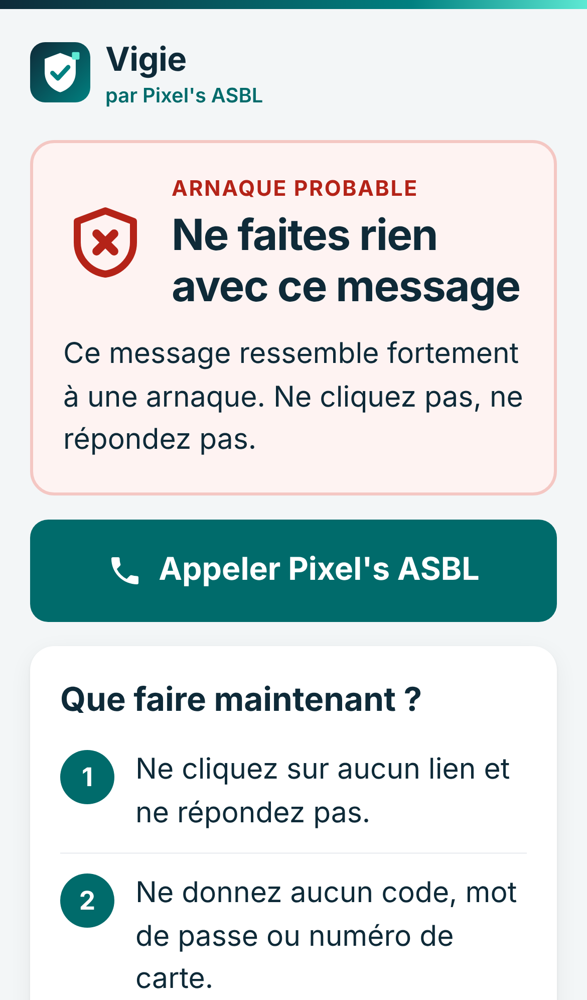

<p align="center"></p>

<p align="center">
<a href="README.md">Français</a> · <a href="README.nl.md">Nederlands</a> · <a href="README.it.md">Italiano</a> · <b>Deutsch</b>
</p>

<p align="center"><b>Ist das Betrug? Prüfen Sie es mit einem Foto.</b><br>
Kostenlos · Ohne Werbung · Nichts wird ins Internet gesendet</p>

---

> **Status:** Prototyp in der Testphase. Privates Repository, bitte nicht weitergeben.
> **Sprache der Anwendung:** vorerst nur Französisch.

## Kurz erklärt

Sie haben eine SMS, eine E-Mail oder einen Brief erhalten, der Sie beunruhigt? Öffnen Sie **Vigie**, fügen Sie die Nachricht ein oder machen Sie ein Foto davon. Nach wenigen Sekunden antwortet Vigie:

- 🔴 **Wahrscheinlich Betrug**: Tun Sie nichts.
- 🟠 **Vorsicht**: Prüfen Sie, bevor Sie handeln.
- 🟢 **Kein bekanntes Anzeichen**: Nichts Verdächtiges gefunden (das ist keine Garantie).

Sie sehen außerdem, **was zu tun ist** (3 einfache Schritte), **warum** Vigie das meint, und eine Taste, um **eine Vertrauensperson anzurufen**.

<p align="center">


</p>

## So funktioniert es

Vigie wird **einmal** auf einem Computer zu Hause installiert. Danach:

- **Am Computer**: Sie öffnen Vigie im Browser (Firefox, Chrome, Edge, Safari).
- **Am Handy oder Tablet** (iPhone, iPad, Android): Sie öffnen Vigie über das WLAN zu Hause, indem Sie einen QR-Code scannen.

Alles geschieht bei Ihnen zu Hause. Nachrichten und Fotos gehen nicht ins Internet und werden nicht gespeichert.

## Installation

Wählen Sie Ihr System. Jeder Schritt wird nur einmal gemacht.

### Linux Fedora (am einfachsten)

1. Laden Sie Vigie herunter: grüne Schaltfläche **Code** → **Download ZIP**, dann die Datei entpacken.
2. Öffnen Sie ein Terminal im Ordner von Vigie.
3. Geben Sie ein:
   ```bash
   bash installer_fedora.sh
   ```
   Auf einem älteren Computer oder einem Computer mit wenig Arbeitsspeicher geben Sie stattdessen `bash installer_fedora.sh --sans-ia` ein.

### Linux Ubuntu oder Debian

```bash
sudo apt install tesseract-ocr tesseract-ocr-fra python3-pip
python3 -m pip install --user -r requirements.txt
```

### Windows 10 oder 11

1. Installieren Sie **Python** von [python.org](https://www.python.org/downloads/). Setzen Sie das Häkchen bei **„Add Python to PATH“**.
2. Installieren Sie **Tesseract** (zum Lesen der Fotos) von [UB-Mannheim/tesseract](https://github.com/UB-Mannheim/tesseract/wiki). Wählen Sie bei der Installation die Sprache **French** aus.
3. Öffnen Sie **PowerShell** im Ordner von Vigie und geben Sie ein:
   ```powershell
   py -m pip install -r requirements.txt
   ```

### macOS

Mit [Homebrew](https://brew.sh):

```bash
brew install tesseract tesseract-lang python
python3 -m pip install -r requirements.txt
```

### Lokale KI (optional)

Sie erklärt das Ergebnis in einfachen Worten. Dafür braucht der Computer **8 GB Arbeitsspeicher**.

1. Installieren Sie [Ollama](https://ollama.com/download).
2. Geben Sie ein: `ollama pull qwen2.5:3b`

Ohne KI funktioniert Vigie trotzdem: Das Urteil hängt nie von ihr ab.

## Benutzung

### Am Computer

```bash
python3 app.py
```

Unter Windows: `py app.py`. Findet Windows Tesseract nicht, geben Sie zuerst ein:
`$env:VIGIE_TESSERACT = "C:\Program Files\Tesseract-OCR\tesseract.exe"`

Öffnen Sie dann **http://127.0.0.1:5000** im Browser.

### Auf einem iPhone, iPad oder Android-Gerät

1. Handy und Computer müssen im **selben WLAN** sein.
2. Geben Sie am Computer ein: `python3 app.py --telephone`
3. Ein **QR-Code** erscheint. Richten Sie die Kamera des Handys darauf und öffnen Sie den Link.
4. Tipp: Legen Sie Vigie auf den Home-Bildschirm.
   - **iPhone / iPad** (Safari): Teilen-Taste → **Zum Home-Bildschirm**.
   - **Android** (Chrome): Menü ⋮ → **Zum Startbildschirm hinzufügen**.

### Eine Nachricht prüfen

- **Prendre en photo** (Foto aufnehmen): Die Kamera öffnet sich. Fotografieren Sie den Bildschirm oder den Brief, auch wenn er einer anderen Person gehört. Das Ergebnis erscheint von selbst.
- **Capture d'écran** (Bildschirmfoto): Wählen Sie ein bereits gespeichertes Bild.
- **Coller** (Einfügen): Fügen Sie den Text der Nachricht ein und drücken Sie dann **Vérifier le message** (Nachricht prüfen).

## Einstellungen

Sie können die Person ändern, die angerufen wird, zum Beispiel ein Familienmitglied:

```bash
VIGIE_AIDANT_NOM="Meine Tochter Julia" VIGIE_AIDANT_TEL="+32470000000" python3 app.py
```

| Einstellung | Wofür | Standard |
| --- | --- | --- |
| `VIGIE_AIDANT_NOM` | Name auf der Anruftaste | Pixel's ASBL |
| `VIGIE_AIDANT_TEL` | Angerufene Nummer | +32456960328 |
| `VIGIE_MODELE` | KI-Modell | qwen2.5:3b |
| `VIGIE_OLLAMA` | Adresse der KI | http://127.0.0.1:11434 |
| `VIGIE_TESSERACT` | Speicherort von Tesseract | tesseract |
| `VIGIE_HOTE` | `0.0.0.0` für das Heimnetz | 127.0.0.1 |
| `VIGIE_PORT` | Port | 5000 |

## Bei Problemen

| Problem | Lösung |
| --- | --- |
| Das Handy öffnet die Seite nicht | Selbes WLAN? Computer eingeschaltet? Unter Fedora: `sudo firewall-cmd --add-port=5000/tcp` |
| „Je n'ai pas réussi à lire l'image“ (Bild nicht gelesen) | Machen Sie das Foto neu: von vorne, gut beleuchtet, ohne Spiegelung. Oder fügen Sie den Text ein. |
| Keine Erklärung der KI | Ollama läuft nicht: kein Problem, das Urteil bleibt zuverlässig. |
| „Vigie n'est pas joignable“ (nicht erreichbar) | Der Computer ist aus, oder das Handy ist nicht mehr im WLAN zu Hause. |

## Nützliche Nummern (Belgien)

- Sie haben einen Code oder Ihre Kartendaten weitergegeben: **Card Stop 078 170 170**, danach Ihre Bank.
- Leiten Sie verdächtige Nachrichten an **suspect@safeonweb.be** weiter.
- Polizei-Notruf: **101**.

## Sicherheit und Datenschutz

- Alles läuft **auf Ihrem Computer**. Fotos werden direkt nach dem Lesen gelöscht.
- Mit `--telephone` kann jede Person im **selben WLAN** Vigie öffnen. Nutzen Sie diesen Modus zu Hause, nie in einem öffentlichen WLAN.
- Vigie ist **eine Hilfe, keine Garantie**. Im Zweifel: Tun Sie nichts und rufen Sie eine Vertrauensperson an.

## Für Techniker

- `app.py`: Webanwendung (Flask), Lesen der Fotos, KI, PWA.
- `regles.py`: Regeln gegen Betrug und offizielle belgische Domains. **Nur diese Regeln bestimmen das Urteil**: ab 5 Punkten rot, von 2 bis 4 orange.
- `test_vigie.py`: Tests (`python3 test_vigie.py`). Fügen Sie jede neue Betrugsmasche anonymisiert hinzu, ebenso echte, seriöse Nachrichten.
- Fotos: Das Handy verkleinert sie (etwa 70 KB), der Computer richtet sie gerade aus, verarbeitet den Dunkelmodus und liest sie mit Tesseract.
- Um Vigie als echte App auf dem Handy zu installieren (auch offline), ist ein **HTTPS**-Zugang nötig. Er ist für die öffentliche Version vorgesehen.

**Farben von Pixel's:** Nachtblau `#0E2A38` · Türkis `#008080` · Mint `#5EEAD4`. Logo: `static/logo.svg`.

## Lizenz und Kontakt

Freie Software unter der Lizenz **GPL-3.0** (siehe [LICENSE](LICENSE)).

**Pixel's ASBL** · Rue Alfred Dendal 56, 7300 Boussu · info@asblpixels.be · +32 456 96 03 28
