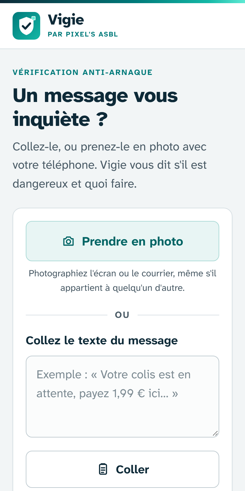
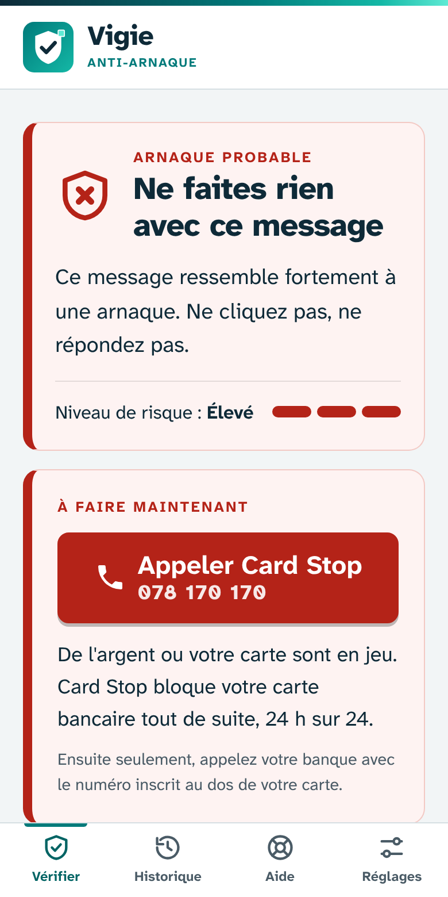

<div align="center">

<picture>
  <source media="(prefers-color-scheme: dark)" srcset="static/logo-sombre.svg">
  
</picture>

### Der kostenlose Offline-Betrugsschutz<br>für alle, die der digitalen Welt fernstehen.

[Français](README.md) · [Nederlands](README.nl.md) · [Italiano](README.it.md) · **Deutsch**


<br>

<picture>
  <source media="(prefers-color-scheme: dark)" srcset="docs/capture-accueil-dark.png">
  
</picture>
&nbsp;&nbsp;
<picture>
  <source media="(prefers-color-scheme: dark)" srcset="docs/capture-arnaque-dark.png">
  
</picture>

</div>

> **Privates Repository.** Vigie befindet sich in Entwicklung und ist noch nicht öffentlich zugänglich.

## Kurz gesagt

Eine SMS, eine E-Mail oder ein Brief beunruhigt Sie? **Fotografieren**, **einfügen** oder aus der App, in der sie steht, zu Vigie **teilen** – Vigie antwortet nach wenigen Sekunden mit einem von drei Urteilen, in großer Schrift und einfacher Sprache:

| Urteil | Was Vigie sagt |
|---|---|
| **Wahrscheinlich Betrug** | Tun Sie nichts mit dieser Nachricht. Hier ist **die eine** Sache, die jetzt zu tun ist. |
| **Vorsicht** | Es gibt verdächtige Hinweise. Prüfen Sie es auf anderem Weg, nie mit der Nummer aus der Nachricht. |
| **Keine bekannten Anzeichen** | Nichts Verdächtiges gefunden, aber bleiben Sie wachsam: Das ist keine Garantie. |

Vigie ist für Menschen gemacht, die wenig mit digitalen Werkzeugen arbeiten: ein Bildschirm, ein Handgriff, große Schaltflächen, eine auf Lesbarkeit ausgelegte Schrift und Vorlesefunktion.

Seit Version **0.4.0** kommt Vigie der Nachricht entgegen: Sie erscheint in der Schaltfläche „Teilen“ von Android, und wenn Sie gerade eine Nachricht kopiert haben, bietet sie an, diese zu prüfen. Sie entscheidet nie an Ihrer Stelle: Sie selbst tippen auf „Prüfen“.

## Warum Vigie

- **Kostenlos und frei.** Kein Abo, kein Konto, keine Werbung. Lizenz GPL-3.0.
- **Offline und privat.** Die Nachricht wird auf dem Gerät analysiert und nirgendwohin gesendet.
- **Transparent.** Die Urteile stammen aus lesbaren Regeln (`regles.py`), nicht aus einer Blackbox. Eine optionale lokale KI darf das Ergebnis erklären, nie entscheiden.
- **Für alle.** Sie dürfen die Nachricht einer anderen Person fotografieren: Eltern, Nachbarn, einen erhaltenen Brief.

## In der Android-App

- **System-Teilen**: in jeder beliebigen App (Nachrichten, Gmail, Browser, Galerie) „Teilen“ und dann **„Mit Vigie prüfen“**. Der Text oder das Bild geht sofort in die Analyse, und das Urteil erscheint ohne weiteren Handgriff – ob Vigie geschlossen war oder schon lief. Eine geteilte E-Mail kommt mit ihrem Betreff an, in dem oft der Köder steckt.
- **Zwischenablage**: beim Öffnen und bei jeder Rückkehr in die App bietet Vigie an, die gerade kopierte Nachricht zu prüfen. Sie analysiert sie **nie** von selbst, schlägt **nie zweimal** denselben Inhalt vor und behält keine lesbare Kopie davon – nur einen kurzen, nicht umkehrbaren Fingerabdruck.
- **Animierte Analyse**: Prozentanzeige in großen Ziffern, Scan-Strahl über dem Foto, Schritte direkt auf dem Bildschirm.
- Klares **Risikoniveau** (niedrig, mittel, hoch) und **eine einzige Handlung**, sofort ausführbar: Card Stop anrufen, die Polizei anrufen, melden und löschen, oder auf anderem Weg prüfen. Die Reihenfolge der Entscheidung liegt fest – eine Drohung gegen eine Person geht vor Geld. Die Erklärung und die weiteren Vorsichtsmaßnahmen folgen danach, eingeklappt unter „Warum?“.
- **Geprüfte Notrufnummern** (`mobile/www/annuaire.json`), vom Ergebnis aus erreichbar über „Ich brauche jetzt Hilfe“. Vigie wählt **nie** eine Nummer aus der analysierten Nachricht und erfindet keine.
- **Verlauf** der geprüften Nachrichten, nur auf dem Telefon gespeichert, abschaltbar und mit einem Tipp löschbar.
- **Hilfe**: was tun nach einem Klick, nach Weitergabe von Codes, nach einer Zahlung oder nach einem falschen Bankanruf; wichtige Nummern.
- Ergebnis **teilen** mit einem Tipp. Die Meldung an Safeonweb bereitet eine E-Mail vor: Sie selbst drücken auf „Senden“.
- **Einstellungen**: Textgröße (3 Stufen), helles, dunkles oder automatisches Design, Vorlesen **mit Wahl der Stimme** und einer Schaltfläche „Beispiel anhören“, Sprache (Französisch, Niederländisch, Italienisch, Deutsch).

## Welche Nummern Vigie anzeigt

Eine falsche Nummer in einer App gegen Betrug wäre genau die Gefahr, die Vigie bekämpft: Das Opfer würde den Betrüger anrufen und glauben, es rufe seine Bank an. Die Regel ist deshalb absolut – **Vigie zeigt keine erfundene oder vermutete Nummer an, keine Nummer aus der analysierten Nachricht und keine von einer nicht offiziellen Website.**

Fest eingetragen sind nur vier Kontakte, von Hand geprüft und mit Datum in `mobile/www/annuaire.json`:

| Kontakt | Wofür |
|---|---|
| **Card Stop — 078 170 170** | Eine belgische Bankkarte sperren, rund um die Uhr |
| **Polizei — 101** | Drohung gegen eine Person |
| **Notruf — 112** | Unmittelbare Gefahr |
| **suspect@safeonweb.be** | Meldung an das Zentrum für Cybersicherheit Belgien |

Für eine Bank, einen Anbieter oder eine Behörde trägt Vigie **nichts** ein: Sie zeigt die offizielle Anweisung – „Rufen Sie Ihre Bank mit der Nummer auf der Rückseite Ihrer Karte an“, „Nehmen Sie die Nummer von einer Papierrechnung“. Diese Nummern und Anweisungen sind Daten, kein Code: `annuaire.json` wird aktualisiert, ohne die App anzufassen. Lädt die Datei nicht, kehrt Vigie zur Liste der Ratschläge zurück – nie zu einer geratenen Nummer.

## Installation

### Android (eigenständige App)

Die App enthält alles: Regeln, Fotoerkennung, Stimme. Sie funktioniert ohne Computer und ohne Internet.

1. Auf GitHub: Reiter **Actions**, letzte Ausführung **Application Android**, Bereich **Artifacts**, dann **Vigie-android** herunterladen.
2. Öffnen Sie `Vigie-android.apk` auf dem Telefon. Android fragt, ob die Installation aus dieser Quelle erlaubt sein soll: Bestätigen Sie dies für diesmal.
3. Öffnen Sie Vigie. Die Kamera wird erst angefordert, wenn Sie auf „Prendre en photo“ (Foto aufnehmen) tippen.

### Computer mit Fedora (und anderen Linux-Systemen)

```bash
git clone https://github.com/asblPixels/vigie.git ~/vigie && cd ~/vigie
bash installer_fedora.sh      # installiert Python, Tesseract (Französisch) und die Abhängigkeiten
python3 app.py                # dann http://127.0.0.1:5000 öffnen
```

### iPhone oder ein Telefon in der Nähe des PCs

```bash
python3 app.py --telephone    # zeigt eine Adresse und einen QR-Code zum Scannen (gleiches WLAN)
```

Öffnen Sie die Adresse in Safari und wählen Sie „Zum Home-Bildschirm“. Eine native iPhone-App gibt es noch nicht (siehe Fahrplan).

## Android-Berechtigungen

Vigie fragt nur das Nötigste ab: die **Kamera**, nur wenn Sie auf « Foto aufnehmen » tippen. Keine Kontakte, kein Mikrofon, kein Standort, kein Speicher, keine SMS, keine Benachrichtigungen. Der Internetzugriff wird vom technischen Rahmen von Android deklariert, Vigie sendet aber keine Daten.

Auch die Neuerungen der Version 0.4.0 verlangen **keine zusätzliche Berechtigung**:

- **Schaltfläche „Teilen“**: Vigie meldet sich im Teilen-Menü von Android an, für Text und Bilder. Sie erhält nur, was Sie ihr selbst senden, und das Recht, das Bild zu lesen, kommt aus dem Teilen selbst.
- **Zwischenablage**: Seit Android 10 darf eine App die Zwischenablage **nur lesen, wenn sie im Vordergrund ist** und den Fokus hat. Eine Überwachung im Hintergrund ist nicht möglich, und Vigie versucht sie auch nicht: Sie schaut beim Öffnen und bei der Rückkehr in die App nach und bietet Ihnen dann an zu prüfen. Mehr nicht.
- **Vorlesen**: nutzt die Sprachausgabe des Telefons, ohne besondere Berechtigung.

Details stehen in der App unter Einstellungen → Über Vigie und Rechtliches (rechtliche Hinweise, DSGVO-Rechte, Berechtigungen).

## Datenschutz

| Daten | Wohin sie gehen |
|---|---|
| Text der Nachricht | Auf dem Gerät analysiert, nie gesendet |
| Foto | Auf dem Gerät gelesen; Vigie behält keine Kopie |
| Aus einer anderen App geteilte Nachricht | Von Android an Vigie übergeben, auf dem Gerät analysiert, nur einmal abgeholt, nie weitergegeben |
| Zwischenablage | Nur gelesen, wenn Vigie im Vordergrund ist; der Inhalt wird nie im Klartext gespeichert, nur ein kurzer, nicht umkehrbarer Fingerabdruck des zuletzt vorgeschlagenen oder weggetippten Inhalts |
| Verlauf | Nur auf dem Gerät, abschaltbar und löschbar |
| Statistiken, Cookies, Konten | Keine |

Die Android-App erzwingt zudem eine Sicherheitsrichtlinie (CSP), die das Laden externer Inhalte untersagt, und enthält keinerlei Tracker.

## Was Vigie nicht tut

- Sie **analysiert nichts von selbst.** Weder die Zwischenablage noch Ihre Nachrichten: Sie selbst tippen auf „Prüfen“ oder teilen eine Nachricht zu ihr.
- Sie **überwacht die Zwischenablage nicht im Hintergrund.** Android lässt das seit Version 10 nicht mehr zu, und Vigie versucht nicht, das zu umgehen.
- Sie **erfindet keine Nummer** und wählt nie die aus der analysierten Nachricht. Bei einer Bank verweist sie auf die Nummer auf der Rückseite der Karte.
- Sie **sendet nichts an Ihrer Stelle.** Die Meldung an Safeonweb ist eine vorbereitete E-Mail: Sie selbst drücken auf „Senden“.
- Sie **ersetzt** weder die Polizei noch Ihre Bank noch eine Vertrauensperson, und „keine bekannten Anzeichen“ ist keine Garantie dafür, dass eine Nachricht sicher ist.

## Unter der Haube

| Baustein | Technologie |
|---|---|
| Erkennung | Lesbare Regeln: offizielle Marken und Domains, Link-Verkürzer, verdächtige Endungen, Drucksprache (`regles.py`) |
| Überall dasselbe Urteil | Die Regeln werden zum Telefon exportiert (`regles.json`); `outils/verifier_parite.py` belegt, dass PC und Android identisch antworten |
| Fotoerkennung | Tesseract (PC) · eingebettetes Tesseract.js mit französischem Sprachpaket (Android) |
| Eine einzige Handlung | Feste Entscheidungsreihenfolge (Drohung → Polizei, Geld → Card Stop, sonst melden oder auf anderem Weg prüfen); Nummern und Anweisungen in `mobile/www/annuaire.json`, von Hand geprüfte Daten, kein Code |
| System-Teilen | Android-`intent-filter` `ACTION_SEND` (`text/plain` und `image/*`) und ein eigenes Capacitor-Plug-in aus dem Repository (`PartagePlugin.java`): Der Inhalt wird an die Weboberfläche übergeben, die ihn vor Ort analysiert. Bild bis 12 MiB; darüber sagt Vigie es, statt abzubrechen |
| Zwischenablage | Lesen nur im Vordergrund; FNV-1a-Fingerabdruck mit 32 Bit des letzten Inhalts, um nie zweimal dasselbe vorzuschlagen |
| Android-App | Capacitor 8, Sprachausgabe mit ausdrücklicher Wahl der Stimme (die natürlichste Stimme der aktuellen Sprache, in den Einstellungen änderbar; schlägt sie fehl, wird mit der Standardstimme vorgelesen) |
| Oberfläche | Ein Stylesheet für PC und Android, helles und dunkles Design, Schrift Atkinson Hyperlegible Next |
| Optionale KI (PC) | Lokales Ollama (`qwen2.5:3b`): erklärt, entscheidet nie |

## Entwickeln

```bash
python3 test_vigie.py                 # 11 Beispielnachrichten
python3 outils/verifier_parite.py     # PC und Telefon geben dasselbe Urteil
python3 outils/exporter_regles.py     # nach jeder Änderung an regles.py
python3 outils/generer_logos.py       # Logos in hell und dunkel

cd mobile && npm ci && npm run sync   # bereitet die Android-App vor
```

Die APK wird von GitHub Actions (`.github/workflows/android.yml`) bei jeder Änderung gebaut und an ein Release angehängt, wenn ein `v…`-Tag gepusht wird.

## Fahrplan

- [x] PC-Prototyp, neu gestaltete Oberfläche, Kamera unter iOS und Android
- [x] Eigenständige Android-App (Regeln, Fotoerkennung, Stimme, 4 Sprachen)
- [ ] Test auf echten Geräten und Signierung der APK für die Verteilung
- [ ] iPhone-App
- [x] Oberfläche auf Niederländisch, Italienisch und Deutsch
- [ ] Regeln um aktuelle Betrugskampagnen in Belgien erweitern

## Wer steht hinter Vigie

Vigie ist freie Software, deren **Konzept von Pixel's ASBL** (Boussu, Belgien) entwickelt wurde, einem Verein, der Menschen im digitalen Alltag begleitet. Pixel's ASBL erhält keine analysierte Nachricht und bietet über die App keinen Support. Für Fragen zum Projekt selbst: Info@asblpixels.be.

Vigie baut auf [Tesseract](https://github.com/tesseract-ocr/tesseract) und [Tesseract.js](https://github.com/naptha/tesseract.js) (Apache-2.0), [Capacitor](https://capacitorjs.com) (MIT), [Flask](https://flask.palletsprojects.com) (BSD-3) und der Schrift [Atkinson Hyperlegible Next](https://brailleinstitute.org/freefont) des Braille Institute (SIL OFL 1.1).

## Mitwirken und Probleme melden

Siehe [CONTRIBUTING.md](CONTRIBUTING.md) und [SECURITY.md](SECURITY.md). Ein Betrug wird nicht erkannt? Eröffnen Sie ein Ticket mit dem Text der Nachricht, **ohne** persönliche Daten.

## Lizenz

[GPL-3.0-or-later](LICENSE) · © Pixel's ASBL
