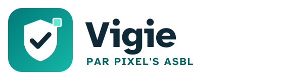
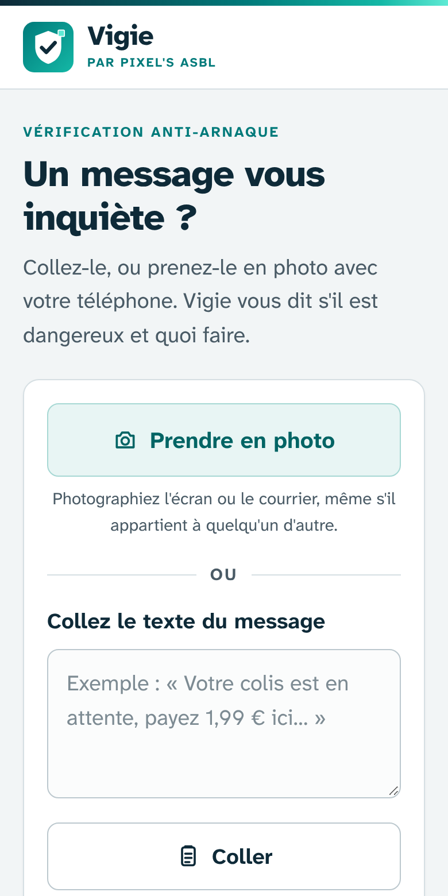
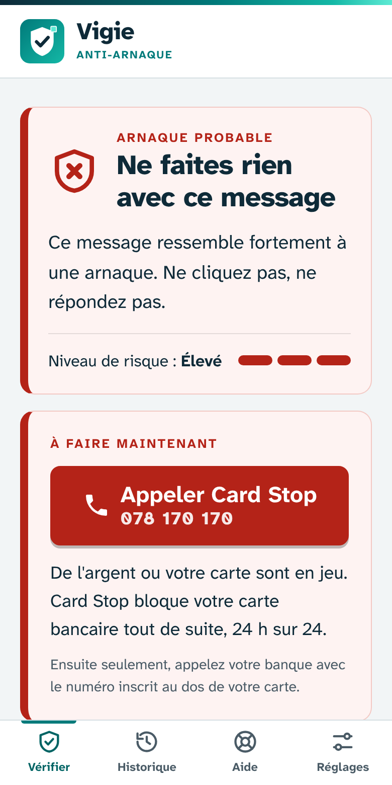

<div align="center">

<picture>
  <source media="(prefers-color-scheme: dark)" srcset="static/logo-sombre.svg">
  
</picture>

### Il copilota anti-truffa, gratuito e offline,<br>per chi è lontano dal mondo digitale.

[Français](README.md) · [Nederlands](README.nl.md) · **Italiano** · [Deutsch](README.de.md)


<br>

<picture>
  <source media="(prefers-color-scheme: dark)" srcset="docs/capture-accueil-dark.png">
  
</picture>
&nbsp;&nbsp;
<picture>
  <source media="(prefers-color-scheme: dark)" srcset="docs/capture-arnaque-dark.png">
  
</picture>

</div>

> **Repository privato.** Vigie è in sviluppo e non è ancora accessibile al pubblico.

## In breve

Un SMS, un'e-mail o una lettera ti preoccupa? **Fotografalo**, **incollalo**, oppure **condividilo** con Vigie dall'app in cui si trova. In pochi secondi Vigie risponde con uno di tre verdetti, a caratteri grandi e con parole semplici:

| Verdetto | Cosa dice Vigie |
|---|---|
| **Truffa probabile** | Non fare nulla con questo messaggio. Ecco **l'unica** cosa da fare, adesso. |
| **Prudenza** | Ci sono indizi preoccupanti. Verifica in un altro modo, mai con il numero del messaggio. |
| **Nessun segnale noto** | Nulla di sospetto, ma resta attento: non è una garanzia. |

Vigie è pensata per chi usa poco gli strumenti digitali: una sola schermata, un solo gesto, pulsanti grandi, un carattere progettato per la leggibilità e la lettura ad alta voce del risultato.

Dalla versione **0.4.0** Vigie va incontro al messaggio: compare nel pulsante « Condividi » di Android e, quando hai appena copiato un messaggio, ti propone di verificarlo. Non decide mai al posto tuo: sei tu a toccare « Verifica ».

## Perché Vigie

- **Gratuita e libera.** Nessun abbonamento, nessun account, nessuna pubblicità. Licenza GPL-3.0.
- **Offline e privata.** Il messaggio viene analizzato sul dispositivo e non è inviato da nessuna parte.
- **Trasparente.** I verdetti nascono da regole leggibili (`regles.py`), non da una scatola nera. Un'IA locale facoltativa può spiegare il risultato, mai deciderlo.
- **Per tutti.** Si può fotografare il messaggio di un'altra persona: un genitore, un vicino, una lettera ricevuta.

## Nell'app Android

- **Condivisione di sistema**: da qualunque app (Messaggi, Gmail, browser, galleria), « Condividi » e poi **« Verifica con Vigie »**. Il testo o l'immagine parte subito per l'analisi e il verdetto appare senza altri gesti, che Vigie sia chiusa o già aperta. Un'e-mail condivisa arriva con il suo oggetto, che spesso contiene l'esca.
- **Appunti**: all'apertura e a ogni ritorno nell'app, Vigie propone di verificare il messaggio che hai appena copiato. Non lo analizza **mai** da sola, non propone **mai due volte** lo stesso contenuto e non ne conserva alcuna copia in chiaro — solo un'impronta breve e non reversibile.
- **Analisi animata**: percentuale a grandi cifre, fascio di scansione sulla foto, passaggi visibili a schermo.
- **Livello di rischio** chiaro (basso, medio, alto) e **una sola azione**, immediatamente eseguibile: chiamare Card Stop, chiamare la polizia, segnalare ed eliminare, oppure verificare in un altro modo. L'ordine di decisione è esplicito: una minaccia verso una persona viene prima del denaro. La spiegazione e le altre precauzioni vengono dopo, raccolte sotto « Perché? ».
- **Numeri d'emergenza verificati** (`mobile/www/annuaire.json`), raggiungibili dal risultato con « Ho bisogno di aiuto adesso ». Vigie non compone **mai** un numero trovato nel messaggio analizzato e non ne inventa alcuno.
- **Cronologia** dei messaggi verificati, conservata sul telefono, disattivabile e cancellabile con un tocco.
- **Aiuto**: cosa fare se si è cliccato, si sono dati i codici, si è pagato o si è ricevuta una finta telefonata della banca; numeri utili.
- **Condividi** il risultato con un tocco. La segnalazione a Safeonweb prepara un'e-mail: sei tu a premere « Invia ».
- **Impostazioni**: dimensione del testo (3 livelli), tema chiaro, scuro o automatico, lettura ad alta voce **con la scelta della voce** e un pulsante « Ascolta un esempio », lingua (francese, olandese, italiano, tedesco).

## I numeri che Vigie mostra

Un numero falso in un'app anti-truffa sarebbe esattamente il pericolo che Vigie combatte: la vittima chiamerebbe il truffatore credendo di chiamare la propria banca. La regola è quindi assoluta — **Vigie non mostra alcun numero inventato o supposto, nessun numero ripreso dal messaggio analizzato e nessun numero trovato su un sito non ufficiale.**

Gli unici contatti scritti nel codice sono quattro, verificati a mano e datati in `mobile/www/annuaire.json`:

| Contatto | A che serve |
|---|---|
| **Card Stop — 078 170 170** | Bloccare una carta bancaria belga, 24 ore su 24 |
| **Polizia — 101** | Minaccia verso una persona |
| **Emergenze — 112** | Pericolo immediato |
| **suspect@safeonweb.be** | Segnalazione al Centro per la Cibersicurezza del Belgio |

Per una banca, un operatore o un ente pubblico Vigie non scrive **nulla**: mostra l'istruzione ufficiale — « chiama la tua banca con il numero sul retro della carta », « riprendi il numero da una fattura cartacea ». Questi numeri e queste istruzioni sono dati, non codice: `annuaire.json` si aggiorna senza toccare l'app. Se il file non si carica, Vigie torna all'elenco dei consigli — mai a un numero indovinato.

## Installare

### Android (app autonoma)

L'app contiene tutto: regole, lettura delle foto, voce. Funziona senza computer e senza Internet.

1. Su GitHub: scheda **Actions**, ultima esecuzione **Application Android**, sezione **Artifacts**, poi scarica **Vigie-android**.
2. Apri `Vigie-android.apk` sul telefono. Android chiederà di autorizzare l'installazione da questa fonte: accetta per questa volta.
3. Apri Vigie. La fotocamera viene richiesta solo quando tocchi « Prendre en photo » (scatta una foto).

### Computer con Fedora (e altri Linux)

```bash
git clone https://github.com/asblPixels/vigie.git ~/vigie && cd ~/vigie
bash installer_fedora.sh      # installa Python, Tesseract (francese) e le dipendenze
python3 app.py                # poi apri http://127.0.0.1:5000
```

### iPhone, o un telefono vicino al PC

```bash
python3 app.py --telephone    # mostra un indirizzo e un codice QR da scansionare (stessa rete Wi-Fi)
```

Apri l'indirizzo in Safari e scegli « Aggiungi alla schermata Home ». Un'app iPhone nativa non esiste ancora (vedi la tabella di marcia).

## Autorizzazioni Android

Vigie chiede lo stretto necessario: la **fotocamera**, solo quando tocchi « Scatta una foto ». Nessun contatto, microfono, posizione, archivio, SMS o notifica. L'accesso a Internet è dichiarato dal quadro tecnico di Android, ma Vigie non invia alcun dato.

Anche le novità della versione 0.4.0 non chiedono **nessuna autorizzazione in più**:

- **Pulsante « Condividi »**: Vigie si dichiara nel menu di condivisione di Android, per il testo e le immagini. Riceve solo ciò che le invii tu, e il diritto di leggere l'immagine è concesso dalla condivisione stessa.
- **Appunti**: da Android 10 un'app può leggere gli appunti **solo quando è in primo piano** e ha il focus. Nessuna sorveglianza in secondo piano è possibile, e Vigie non ne tenta alcuna: guarda all'apertura e al ritorno nell'app, poi ti propone di verificare. Nulla di più.
- **Lettura ad alta voce**: usa la sintesi vocale del telefono, senza autorizzazioni particolari.

I dettagli sono nell'app, in Impostazioni → Informazioni e note legali (note legali, diritti GDPR, autorizzazioni).

## Privacy

| Dato | Dove va |
|---|---|
| Testo del messaggio | Analizzato sul dispositivo, mai inviato |
| Foto | Letta sul dispositivo; Vigie non ne conserva alcuna copia |
| Messaggio condiviso da un'altra app | Consegnato a Vigie da Android, analizzato sul dispositivo, ripreso una sola volta, mai trasmesso |
| Appunti | Letti solo quando Vigie è in primo piano; il contenuto non è mai registrato in chiaro, resta solo un'impronta breve e non reversibile dell'ultimo contenuto proposto o scartato |
| Cronologia | Solo sul dispositivo, disattivabile e cancellabile |
| Statistiche, cookie, account | Nessuno |

L'app Android impone inoltre una politica di sicurezza (CSP) che vieta il caricamento di contenuti esterni e non include alcun tracker.

## Cosa Vigie non fa

- **Non analizza nulla da sola.** Né gli appunti né i tuoi messaggi: sei tu a toccare « Verifica », o a condividere un messaggio con lei.
- **Non sorveglia gli appunti in secondo piano.** Android non lo permette più dalla versione 10, e Vigie non cerca di aggirarlo.
- **Non inventa alcun numero** e non compone mai quello del messaggio analizzato. Per una banca rimanda al numero stampato sul retro della carta.
- **Non invia nulla al posto tuo.** La segnalazione a Safeonweb è un'e-mail già pronta: sei tu a premere « Invia ».
- **Non sostituisce** la polizia, la tua banca o una persona di fiducia, e « nessun segnale noto » non è una garanzia di sicurezza.

## Sotto il cofano

| Elemento | Tecnologia |
|---|---|
| Rilevamento | Regole leggibili: marchi e domini ufficiali, accorciatori di link, estensioni sospette, linguaggio di pressione (`regles.py`) |
| Stesso verdetto ovunque | Le regole sono esportate sul telefono (`regles.json`); `outils/verifier_parite.py` dimostra che PC e Android rispondono in modo identico |
| Lettura delle foto | Tesseract (PC) · Tesseract.js incorporato con la lingua francese (Android) |
| Una sola azione | Ordine di decisione esplicito (minaccia → polizia, denaro → Card Stop, altrimenti segnalare o verificare in un altro modo); numeri e istruzioni in `mobile/www/annuaire.json`, dati verificati a mano, non codice |
| Condivisione di sistema | `intent-filter` Android `ACTION_SEND` (`text/plain` e `image/*`) e un plugin Capacitor del repository (`PartagePlugin.java`): il contenuto è consegnato all'interfaccia web, che lo analizza sul posto. Immagine accettata fino a 12 MiB, oltre Vigie lo dice invece di fermarsi |
| Appunti | Lettura solo in primo piano; impronta FNV-1a a 32 bit dell'ultimo contenuto, per non proporre mai due volte la stessa cosa |
| App Android | Capacitor 8, sintesi vocale con scelta esplicita della voce (la voce più naturale per la lingua in uso, modificabile nelle impostazioni; in caso di errore la lettura avviene con la voce predefinita) |
| Interfaccia | Un solo foglio di stile per PC e Android, tema chiaro e scuro, carattere Atkinson Hyperlegible Next |
| IA facoltativa (PC) | Ollama in locale (`qwen2.5:3b`): spiega, non decide mai |

## Sviluppare

```bash
python3 test_vigie.py                 # 11 messaggi di prova
python3 outils/verifier_parite.py     # PC e telefono danno lo stesso verdetto
python3 outils/exporter_regles.py     # dopo ogni modifica a regles.py
python3 outils/generer_logos.py       # loghi chiaro e scuro

cd mobile && npm ci && npm run sync   # prepara l'app Android
```

L'APK viene costruito da GitHub Actions (`.github/workflows/android.yml`) a ogni modifica e allegato a una release quando si invia un tag `v…`.

## Tabella di marcia

- [x] Prototipo per PC, interfaccia ripensata, fotocamera su iOS e Android
- [x] App Android autonoma (regole, lettura delle foto, voce, 4 lingue)
- [ ] Prove su dispositivi reali e firma dell'APK per la distribuzione
- [ ] App per iPhone
- [x] Interfaccia in olandese, italiano e tedesco
- [ ] Regole arricchite con le recenti campagne di truffe in Belgio

## Chi c'è dietro Vigie

Vigie è un software libero il cui **concetto è stato ideato da Pixel's ASBL** (Boussu, Belgio), un'associazione che accompagna le persone nella loro vita digitale. Pixel's ASBL non riceve alcun messaggio analizzato e non offre assistenza tramite l'app. Per una domanda sul progetto: Info@asblpixels.be.

Vigie si basa su [Tesseract](https://github.com/tesseract-ocr/tesseract) e [Tesseract.js](https://github.com/naptha/tesseract.js) (Apache-2.0), [Capacitor](https://capacitorjs.com) (MIT), [Flask](https://flask.palletsprojects.com) (BSD-3) e sul carattere [Atkinson Hyperlegible Next](https://brailleinstitute.org/freefont) del Braille Institute (SIL OFL 1.1).

## Contribuire e segnalare un problema

Vedi [CONTRIBUTING.md](CONTRIBUTING.md) e [SECURITY.md](SECURITY.md). Una truffa non viene rilevata? Apri una segnalazione con il testo del messaggio, **senza** dati personali.

## Licenza

[GPL-3.0-or-later](LICENSE) · © Pixel's ASBL
