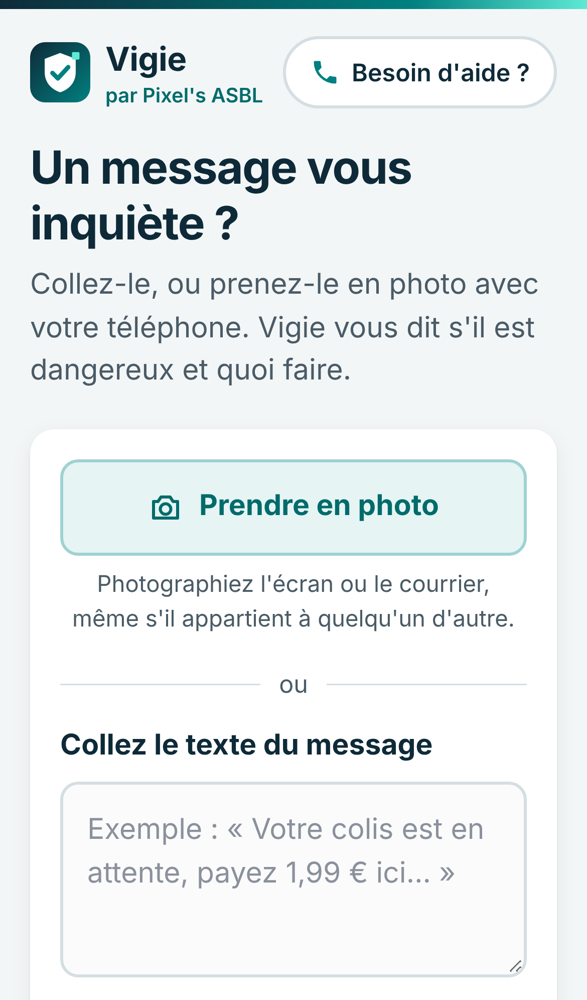

<p align="center"></p>

<p align="center"><b>Est-ce une arnaque ? Vérifiez en une photo.</b><br>
Gratuit · Sans publicité · Rien n'est envoyé sur Internet</p>

---

**Vigie** est le copilote anti-arnaque de **Pixel's ASBL** (Boussu, Belgique). Devant un SMS, un mail, un courrier ou un écran qui inquiète, on colle le texte ou on prend une photo. Vigie répond en français simple :

- 🔴 **Arnaque probable**, 🟠 **Prudence** ou 🟢 **Aucun signe connu**
- **Que faire maintenant** : 3 étapes claires, et un bouton pour **appeler son aidant**
- **Pourquoi** : les indices trouvés, avec une explication par IA locale (facultative)

<p align="center">


</p>

> **Statut :** prototype, dépôt privé. Ne pas diffuser avant la validation sur le terrain.

## Plateformes

| Où | Comment |
| --- | --- |
| **Linux** (Fedora, Ubuntu, Debian…) | Installé sur le PC, ouvert dans le navigateur |
| **Windows 10/11** | Installé sur le PC, ouvert dans le navigateur |
| **macOS** | Installé sur le Mac, ouvert dans le navigateur |
| **iPhone / iPad** | Safari, via le PC de la maison (même Wi-Fi). Ajout à l'écran d'accueil possible |
| **Android** | Chrome, via le PC de la maison (même Wi-Fi). Ajout à l'écran d'accueil possible |

Vigie tourne sur un ordinateur : c'est lui qui lit les photos et fait tourner l'IA. Les téléphones s'y connectent par le Wi-Fi.

## Installation

### Fedora (script automatique)

```bash
bash installer_fedora.sh            # tout, avec l'IA locale (8 Go de RAM conseillés)
bash installer_fedora.sh --sans-ia  # PC modeste : règles + lecture des photos seulement
```

### Ubuntu / Debian

```bash
sudo apt install tesseract-ocr tesseract-ocr-fra python3-pip
python3 -m pip install --user -r requirements.txt
```

### Windows

1. Installez **Python 3** depuis [python.org](https://www.python.org/downloads/), en cochant « Add Python to PATH ».
2. Installez **Tesseract** (version Windows de l'université de Mannheim : [github.com/UB-Mannheim/tesseract](https://github.com/UB-Mannheim/tesseract/wiki)), en cochant la langue **French**.
3. Dans un terminal, depuis le dossier de Vigie :
   ```powershell
   py -m pip install -r requirements.txt
   $env:VIGIE_TESSERACT = "C:\Program Files\Tesseract-OCR\tesseract.exe"
   py app.py
   ```

### macOS

```bash
brew install tesseract tesseract-lang python
python3 -m pip install -r requirements.txt
```

### IA locale (facultative, toutes plateformes)

Installez [Ollama](https://ollama.com/download), puis lancez `ollama pull qwen2.5:3b`. Sans Ollama, Vigie fonctionne quand même : le verdict vient toujours des règles.

## Lancement

```bash
python3 app.py              # sur cet ordinateur : http://127.0.0.1:5000
python3 app.py --telephone  # ouvre aussi Vigie aux téléphones du même Wi-Fi (affiche un QR code)
```

### Depuis un iPhone ou un Android

1. Lancez `python3 app.py --telephone` sur le PC.
2. Visez le **QR code** affiché dans le terminal avec l'appareil photo du téléphone.
3. Ajoutez la page à l'écran d'accueil : sur iPhone, Partager → *Sur l'écran d'accueil* ; sur Android, menu ⋮ → *Ajouter à l'écran d'accueil*.

**Prendre en photo** ouvre directement l'appareil photo : on peut photographier l'écran ou le courrier de quelqu'un d'autre. L'analyse démarre dès que la photo est prise. **Capture d'écran** permet de choisir une image dans la galerie.

Si le téléphone n'arrive pas à se connecter, le pare-feu de Fedora bloque peut-être le port : `sudo firewall-cmd --add-port=5000/tcp` (jusqu'au prochain redémarrage).

**Sécurité :** en mode `--telephone`, toute personne connectée au même Wi-Fi peut ouvrir Vigie. Utilisez ce mode à la maison, jamais sur un Wi-Fi public.

> Pour installer Vigie comme une vraie application sur le téléphone (icône, fonctionnement hors ligne), il faut un accès en **HTTPS**, à prévoir pour la version publique. En attendant, le raccourci sur l'écran d'accueil fonctionne.

## Configuration

| Variable | Rôle | Défaut |
| --- | --- | --- |
| `VIGIE_AIDANT_NOM` | Nom affiché sur le bouton d'appel | Pixel's ASBL |
| `VIGIE_AIDANT_TEL` | Numéro appelé | +32456960328 |
| `VIGIE_MODELE` | Modèle Ollama | qwen2.5:3b |
| `VIGIE_OLLAMA` | Adresse d'Ollama | http://127.0.0.1:11434 |
| `VIGIE_TESSERACT` | Commande ou chemin de Tesseract | tesseract |
| `VIGIE_HOTE` | Adresse d'écoute (`0.0.0.0` = réseau local) | 127.0.0.1 |
| `VIGIE_PORT` | Port | 5000 |

Exemple, pour l'aidant d'un bénéficiaire :

```bash
VIGIE_AIDANT_NOM="Ma fille Julie" VIGIE_AIDANT_TEL="+32470000000" python3 app.py
```

## Fonctionnement

1. **Lecture** : le texte collé, ou la photo. Le téléphone la réduit (environ 70 Ko), puis le PC la redresse, renforce le contraste, gère le mode sombre et la lit avec Tesseract.
2. **Règles** (`regles.py`) : chaque indice ajoute des points. À partir de 5 points, le verdict est rouge ; de 2 à 4, orange.
3. **IA locale** (Ollama) : elle explique « ce que c'est » et « pourquoi ». **Elle ne décide jamais du verdict.**

## Identité visuelle

Couleurs de Pixel's ASBL, utilisées avec modération :

| Rôle | Couleur |
| --- | --- |
| Bleu nuit : texte, action principale | `#0E2A38` |
| Turquoise : appel, repères | `#008080` / `#006B6B` |
| Menthe : touche d'accent | `#5EEAD4` |

Les couleurs des verdicts (rouge, orange, vert) restent séparées de la marque, pour garder leur sens. Logo : `static/logo.svg` (horizontal) et `static/logo-icone.svg` (icône).

## Tests

```bash
python3 test_vigie.py
```

Ajoutez dans `test_vigie.py` chaque arnaque rencontrée sur le terrain (version anonymisée), ainsi que de vrais messages légitimes pour éviter les fausses alertes.

## Limites

Vigie est **une aide, pas une garantie**. Un message vert peut quand même être une arnaque nouvelle. En cas de doute : ne rien faire et appeler son aidant.

## Licence

GPL-3.0, voir [LICENSE](LICENSE). © 2026 Pixel's ASBL, Rue Alfred Dendal 56, 7300 Boussu · info@asblpixels.be
