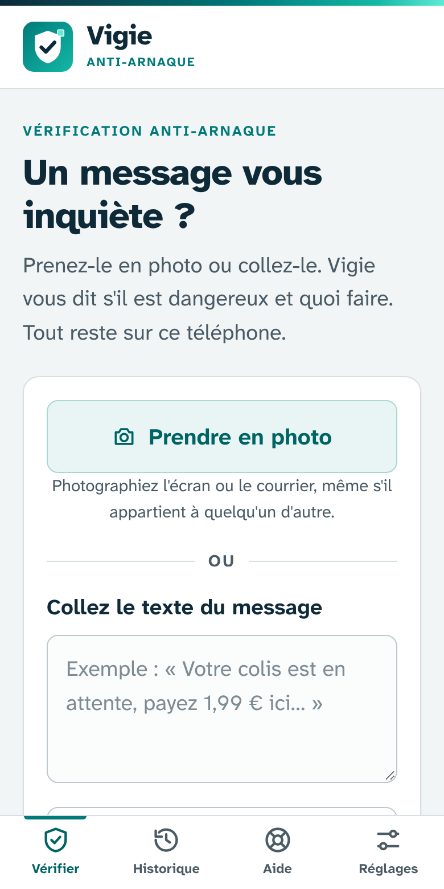
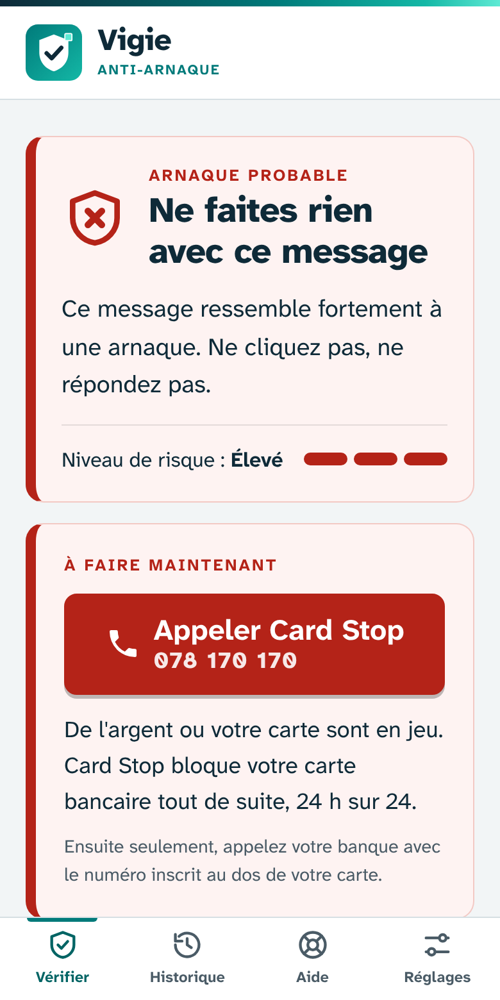

<div align="center">

<picture>
  <source media="(prefers-color-scheme: dark)" srcset="static/logo-sombre.svg">
  
</picture>

### Le copilote anti-arnaque, gratuit et hors ligne,<br>pour celles et ceux qui sont loin du numérique.

**Français** · [Nederlands](README.nl.md) · [Italiano](README.it.md) · [Deutsch](README.de.md)


<br>

<picture>
  <source media="(prefers-color-scheme: dark)" srcset="docs/capture-accueil-dark.png">
  
</picture>
&nbsp;&nbsp;
<picture>
  <source media="(prefers-color-scheme: dark)" srcset="docs/capture-arnaque-dark.png">
  
</picture>

</div>

> **Dépôt privé.** Vigie est en cours de développement et n'est pas encore accessible au public.

## En bref

Un SMS, un courriel ou un courrier vous inquiète ? Vous le **photographiez**, vous le **collez**, ou vous le **partagez** vers Vigie depuis l'application où il se trouve. En quelques secondes, Vigie répond par l'un de trois verdicts, en grands caractères et en langage simple :

| Verdict | Ce que Vigie vous dit |
|---|---|
| **Arnaque probable** | Ne faites rien avec ce message. Voici **la** chose à faire, maintenant. |
| **Prudence** | Des indices inquiètent. Vérifiez autrement, jamais avec le numéro du message. |
| **Aucun signe connu** | Rien de suspect trouvé, mais restez attentif : ce n'est pas une garantie. |

Vigie est pensée pour les personnes éloignées des outils numériques : un seul écran, un seul geste, de gros boutons, une police conçue pour la lisibilité, et une lecture à voix haute du résultat.

Depuis la version **0.4.0**, Vigie vient au-devant du message : elle apparaît dans le bouton « Partager » d'Android, et quand vous venez de copier un message, elle propose de le vérifier. Elle ne décide jamais à votre place : c'est vous qui touchez « Vérifier ».

## Pourquoi Vigie

- **Gratuite et libre.** Pas d'abonnement, pas de compte, pas de publicité. Licence GPL-3.0.
- **Hors ligne et privée.** Le message est analysé sur l'appareil. Il n'est envoyé nulle part.
- **Transparente.** Les verdicts viennent de règles lisibles (`regles.py`), pas d'une boîte noire. Une IA locale facultative peut expliquer le résultat, jamais le décider.
- **Pour tout le monde.** On peut photographier le message d'une autre personne : un parent, un voisin, un courrier reçu.

## Dans l'application Android

- **Partage système** : dans n'importe quelle application (Messages, Gmail, navigateur, galerie), « Partager » puis **« Vérifier avec Vigie »**. Le texte ou l'image part aussitôt à l'analyse et le verdict s'affiche sans autre geste, que Vigie soit fermée ou déjà ouverte. Un courriel partagé arrive avec son objet, qui porte souvent l'appât.
- **Presse-papier** : à l'ouverture et à chaque retour dans l'application, Vigie propose de vérifier le message que vous venez de copier. Elle ne l'analyse **jamais** d'elle-même, ne propose **jamais deux fois** le même contenu, et n'en garde aucune copie en clair — seulement une empreinte courte et non réversible.
- **Analyse animée** : pourcentage en grands chiffres, faisceau de scan sur la photo, étapes lues à l'écran.
- **Niveau de risque** clair (faible, moyen, élevé) et **une seule action**, immédiatement exécutable : appeler Card Stop, appeler la police, signaler et supprimer, ou vérifier autrement. L'ordre de décision est explicite — une menace envers une personne passe avant l'argent. L'explication et les autres précautions viennent ensuite, repliées sous « Pourquoi ? ».
- **Numéros d'urgence vérifiés** (`mobile/www/annuaire.json`), accessibles depuis le résultat par « J'ai besoin d'aide maintenant ». Vigie ne compose **jamais** un numéro trouvé dans le message analysé et n'en invente aucun.
- **Historique** des messages vérifiés, gardé sur le téléphone, désactivable et effaçable en un geste.
- **Aide** : que faire si l'on a cliqué, donné ses codes, payé ou reçu un faux appel de banque ; numéros utiles.
- **Partager** le résultat en un geste. Le signalement à Safeonweb prépare un courriel : c'est l'utilisateur qui appuie sur « Envoyer ».
- **Réglages** : taille du texte (3 niveaux), thème clair, sombre ou automatique, lecture à voix haute **avec le choix de la voix** et un bouton « Écouter un exemple », langue (français, néerlandais, italien, allemand).

## Les numéros que Vigie affiche

Un faux numéro dans une application anti-arnaque serait exactement le danger que Vigie combat : la victime appellerait l'escroc en croyant appeler sa banque. La règle est donc absolue — **Vigie n'affiche aucun numéro inventé, supposé, repris du message analysé ou trouvé sur un site non officiel.**

Les seuls contacts écrits en dur sont au nombre de quatre, vérifiés à la main et datés dans `mobile/www/annuaire.json` :

| Contact | Pourquoi |
|---|---|
| **Card Stop — 078 170 170** | Blocage d'une carte bancaire belge, 24 h sur 24 |
| **Police — 101** | Menace envers une personne |
| **Urgences — 112** | Danger immédiat |
| **suspect@safeonweb.be** | Signalement au Centre pour la Cybersécurité Belgique |

Pour une banque, un opérateur ou une administration, Vigie n'inscrit **rien** : elle affiche la consigne officielle — « appelez votre banque avec le numéro inscrit au dos de votre carte », « reprenez le numéro sur une facture papier ». Ces numéros et ces consignes sont de la donnée, pas du code : `annuaire.json` se met à jour sans toucher à l'application. Si ce fichier ne se charge pas, Vigie revient à la liste de conseils — jamais à un numéro deviné.

## Installer

### Android (application autonome)

L'application contient tout : règles, lecture des photos, voix. Elle fonctionne sans ordinateur et sans Internet.

1. Sur GitHub : onglet **Actions**, dernière exécution **Application Android**, section **Artifacts**, puis téléchargez **Vigie-android**.
2. Ouvrez le fichier `Vigie-android.apk` sur le téléphone. Android demandera d'autoriser l'installation depuis cette source : acceptez pour cette fois.
3. Ouvrez Vigie. L'appareil photo n'est demandé que lorsque vous touchez « Prendre en photo ».

### Ordinateur sous Fedora (et autres Linux)

```bash
git clone https://github.com/asblPixels/vigie.git ~/vigie && cd ~/vigie
bash installer_fedora.sh      # installe Python, Tesseract (français) et les dépendances
python3 app.py                # puis ouvrez http://127.0.0.1:5000
```

### iPhone, ou un téléphone proche du PC

```bash
python3 app.py --telephone    # affiche une adresse et un QR code à scanner (même Wi-Fi)
```

Ouvrez l'adresse dans Safari, puis « Ajouter à l'écran d'accueil ». Une application iPhone native n'existe pas encore (voir la feuille de route).

## Autorisations Android

Vigie demande le strict minimum : l'**appareil photo**, seulement quand vous touchez « Prendre en photo ». Elle ne demande ni contacts, ni micro, ni position, ni stockage, ni SMS, ni notifications. L'accès à Internet est déclaré par le cadre technique d'Android, mais Vigie n'envoie aucune donnée.

Les nouveautés de la version 0.4.0 ne demandent, elles non plus, **aucune autorisation supplémentaire** :

- **Bouton « Partager »** : Vigie se déclare dans la feuille de partage d'Android, pour le texte et les images. Elle ne reçoit que ce que vous lui envoyez vous-même, et le droit de lire l'image est accordé par le partage lui-même.
- **Presse-papier** : depuis Android 10, une application ne peut lire le presse-papier **que lorsqu'elle est au premier plan** et qu'elle a le focus. Aucune surveillance en arrière-plan n'est possible, et Vigie n'en tente aucune : elle regarde à l'ouverture et au retour dans l'application, puis vous propose de vérifier. Rien de plus.
- **Lecture à voix haute** : utilise la synthèse vocale du téléphone, sans autorisation particulière.

Le détail figure dans l'application, sous Réglages → À propos et mentions légales (mentions légales, droits RGPD, autorisations).

## Vie privée

| Donnée | Où elle va |
|---|---|
| Texte du message | Analysé sur l'appareil, jamais envoyé |
| Photo | Lue sur l'appareil ; Vigie n'en conserve aucune copie |
| Message partagé depuis une autre application | Remis à Vigie par Android, analysé sur l'appareil, repris une seule fois, jamais transmis |
| Presse-papier | Lu uniquement quand Vigie est au premier plan ; le contenu n'est jamais enregistré en clair, seule une empreinte courte et non réversible du dernier contenu proposé ou écarté est gardée |
| Historique | Sur l'appareil uniquement, désactivable, effaçable |
| Statistiques, cookies, comptes | Aucun |

L'application Android impose en outre une politique de sécurité (CSP) qui interdit tout chargement de contenu extérieur, et elle n'embarque aucun traceur.

## Ce que Vigie ne fait pas

- Elle **n'analyse rien toute seule.** Ni le presse-papier, ni vos messages : c'est vous qui touchez « Vérifier », ou qui partagez un message vers elle.
- Elle **ne surveille pas le presse-papier en arrière-plan.** Android ne le permet plus depuis la version 10, et Vigie ne cherche pas à le contourner.
- Elle **n'invente aucun numéro** et ne compose jamais celui du message analysé. Pour une banque, elle renvoie au numéro inscrit au dos de la carte.
- Elle **n'envoie rien à votre place.** Le signalement à Safeonweb est un courriel préparé : c'est vous qui appuyez sur « Envoyer ».
- Elle **ne remplace pas** la police, votre banque ni une personne de confiance, et « aucun signe connu » n'est pas une garantie de sécurité.

## Sous le capot

| Élément | Technologie |
|---|---|
| Détection | Règles lisibles : marques et domaines officiels, raccourcisseurs de liens, extensions suspectes, vocabulaire de pression (`regles.py`) |
| Même verdict partout | Les règles sont exportées vers le téléphone (`regles.json`) ; `outils/verifier_parite.py` prouve que PC et Android répondent à l'identique |
| Lecture des photos | Tesseract (PC) · Tesseract.js embarqué avec la langue française (Android) |
| Une seule action | Ordre de décision explicite (menace → police, argent → Card Stop, sinon signaler ou vérifier autrement) ; numéros et consignes dans `mobile/www/annuaire.json`, de la donnée vérifiée à la main, pas du code |
| Partage système | `intent-filter` Android `ACTION_SEND` (`text/plain` et `image/*`) et un greffon Capacitor du dépôt (`PartagePlugin.java`) : le contenu est remis à l'interface web, qui l'analyse sur place. Image acceptée jusqu'à 12 Mio, au-delà Vigie le dit au lieu de s'arrêter |
| Presse-papier | Lecture au premier plan uniquement ; empreinte FNV-1a 32 bits du dernier contenu, pour ne jamais proposer deux fois la même chose |
| Application Android | Capacitor 8, synthèse vocale avec choix explicite de la voix (la voix la plus naturelle de la langue en cours, modifiable dans les réglages ; en cas d'échec, lecture avec la voix par défaut) |
| Interface | Une seule feuille de style pour le PC et Android, thème clair et sombre, police Atkinson Hyperlegible Next |
| IA facultative (PC) | Ollama en local (`qwen2.5:3b`) : explique, ne décide jamais |

## Développer

```bash
python3 test_vigie.py                 # 11 messages types
python3 outils/verifier_parite.py     # PC et téléphone donnent le même verdict
python3 outils/exporter_regles.py     # après toute modification de regles.py
python3 outils/generer_logos.py       # logos clair et sombre

cd mobile && npm ci && npm run sync   # prépare l'application Android
```

L'APK est construit par GitHub Actions (`.github/workflows/android.yml`) à chaque modification, et attaché à une version quand on pousse une étiquette `v…`.

## Feuille de route

- [x] Prototype PC, interface repensée, appareil photo iOS et Android
- [x] Application Android autonome (règles, lecture des photos, voix, 4 langues)
- [ ] Test sur appareils réels et signature de l'APK pour distribution
- [ ] Application iPhone
- [x] Interface en néerlandais, italien et allemand
- [ ] Règles enrichies avec les campagnes d'arnaques belges récentes

## Qui est derrière Vigie

Vigie est un logiciel libre dont le **concept a été conçu par Pixel's ASBL** (Boussu, Belgique), une association qui accompagne les personnes dans leur vie numérique. Pixel's ASBL ne reçoit aucun message analysé et n'assure pas d'assistance par l'application. Pour une question sur le projet lui-même : Info@asblpixels.be.

Vigie s'appuie sur [Tesseract](https://github.com/tesseract-ocr/tesseract) et [Tesseract.js](https://github.com/naptha/tesseract.js) (Apache-2.0), [Capacitor](https://capacitorjs.com) (MIT), [Flask](https://flask.palletsprojects.com) (BSD-3) et la police [Atkinson Hyperlegible Next](https://brailleinstitute.org/freefont) du Braille Institute (SIL OFL 1.1).

## Contribuer et signaler un problème

Voir [CONTRIBUTING.md](CONTRIBUTING.md) et [SECURITY.md](SECURITY.md). Une arnaque qui n'est pas détectée ? Ouvrez un ticket avec le texte du message, **sans** données personnelles.

## Licence

[GPL-3.0-or-later](LICENSE) · © Pixel's ASBL
