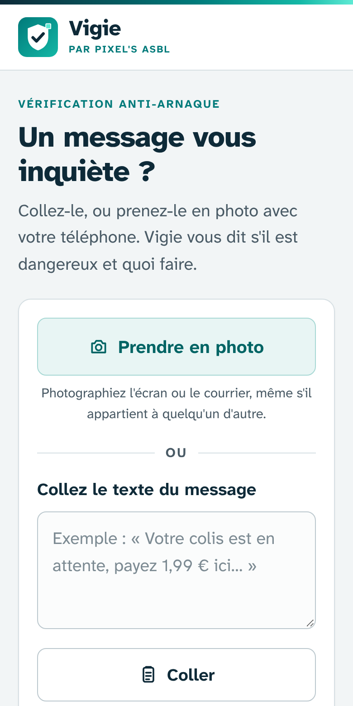
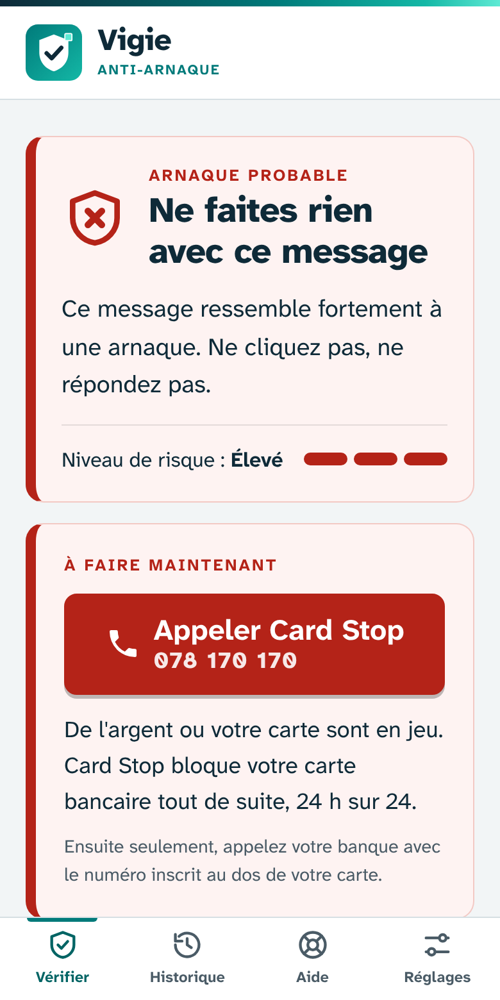

<div align="center">

<picture>
  <source media="(prefers-color-scheme: dark)" srcset="static/logo-sombre.svg">
  
</picture>

### De gratis, offline anti-oplichtingshulp<br>voor wie weinig thuis is in de digitale wereld.

[Français](README.md) · **Nederlands** · [Italiano](README.it.md) · [Deutsch](README.de.md)


<br>

<picture>
  <source media="(prefers-color-scheme: dark)" srcset="docs/capture-accueil-dark.png">
  
</picture>
&nbsp;&nbsp;
<picture>
  <source media="(prefers-color-scheme: dark)" srcset="docs/capture-arnaque-dark.png">
  
</picture>

</div>

> **Privé-repository.** Vigie is in ontwikkeling en nog niet voor het publiek toegankelijk.

## In het kort

Maakt een sms, e-mail of brief u ongerust? **Fotografeer** hem, **plak** hem, of **deel** hem naar Vigie vanuit de app waarin hij staat. Binnen enkele seconden geeft Vigie een van drie uitspraken, in grote letters en eenvoudige taal:

| Uitspraak | Wat Vigie zegt |
|---|---|
| **Waarschijnlijk oplichting** | Doe niets met dit bericht. Dit is **de** stap die u nu zet. |
| **Wees voorzichtig** | Er zijn verdachte signalen. Controleer het anders, nooit met het nummer uit het bericht. |
| **Geen bekende signalen** | Niets verdachts gevonden, maar blijf alert: het is geen garantie. |

Vigie is gemaakt voor mensen die weinig met digitale hulpmiddelen werken: één scherm, één handeling, grote knoppen, een lettertype dat is ontworpen voor leesbaarheid en een voorleesfunctie.

Sinds versie **0.4.0** komt Vigie het bericht tegemoet: ze verschijnt in de knop "Delen" van Android, en wanneer u net een bericht hebt gekopieerd, stelt ze voor om het te controleren. Ze beslist nooit in uw plaats: ú tikt op "Controleren".

## Waarom Vigie

- **Gratis en vrij.** Geen abonnement, geen account, geen reclame. Licentie GPL-3.0.
- **Offline en privé.** Het bericht wordt op het toestel geanalyseerd en nergens naartoe verstuurd.
- **Transparant.** De uitspraken komen uit leesbare regels (`regles.py`), niet uit een zwarte doos. Een optionele lokale AI kan het resultaat toelichten, nooit bepalen.
- **Voor iedereen.** U mag het bericht van iemand anders fotograferen: een ouder, een buur, een ontvangen brief.

## In de Android-app

- **Systeemdeling**: in eender welke app (Berichten, Gmail, browser, galerij) kiest u "Delen" en dan **"Controleren met Vigie"**. De tekst of de afbeelding gaat meteen naar de analyse en de uitspraak verschijnt zonder verdere handeling, of Vigie nu gesloten is of al open stond. Een gedeelde e-mail komt binnen mét zijn onderwerp, waar het lokaas vaak in zit.
- **Klembord**: bij het openen en bij elke terugkeer in de app stelt Vigie voor om het bericht te controleren dat u net hebt gekopieerd. Ze analyseert het **nooit** uit zichzelf, stelt **nooit twee keer** dezelfde inhoud voor en bewaart er geen leesbare kopie van — enkel een korte, onomkeerbare vingerafdruk.
- **Geanimeerde analyse**: percentage in grote cijfers, scanbalk over de foto, stappen die u op het scherm volgt.
- Duidelijk **risiconiveau** (laag, middel, hoog) en **één enkele stap**, meteen uitvoerbaar: Card Stop bellen, de politie bellen, melden en verwijderen, of het anders controleren. De volgorde van beslissen ligt vast — een bedreiging tegen een persoon gaat vóór geld. De uitleg en de overige voorzorgen volgen daarna, ingeklapt onder "Waarom?".
- **Geverifieerde noodnummers** (`mobile/www/annuaire.json`), vanuit het resultaat bereikbaar via "Ik heb nu hulp nodig". Vigie belt **nooit** een nummer uit het geanalyseerde bericht en verzint er geen.
- **Geschiedenis** van gecontroleerde berichten, bewaard op de telefoon, uit te schakelen en met één tik te wissen.
- **Hulp**: wat te doen na een klik, na het geven van codes, na een betaling of na een valse bankoproep; nuttige nummers.
- Het resultaat **delen** met één tik. De melding aan Safeonweb maakt een e-mail klaar: ú drukt op "Verzenden".
- **Instellingen**: tekstgrootte (3 niveaus), licht, donker of automatisch thema, voorlezen **met keuze van de stem** en een knop "Voorbeeld beluisteren", taal (Frans, Nederlands, Italiaans, Duits).

## De nummers die Vigie toont

Een vals nummer in een app tegen oplichting zou precies het gevaar zijn dat Vigie bestrijdt: het slachtoffer zou de oplichter bellen in de overtuiging zijn bank te bellen. De regel is dus absoluut — **Vigie toont geen enkel verzonnen of vermoed nummer, geen nummer uit het geanalyseerde bericht en geen nummer van een niet-officiële site.**

De enige vast ingeschreven contacten zijn er vier, met de hand geverifieerd en gedateerd in `mobile/www/annuaire.json`:

| Contact | Waarvoor |
|---|---|
| **Card Stop — 078 170 170** | Een Belgische bankkaart blokkeren, 24 uur op 24 |
| **Politie — 101** | Bedreiging tegen een persoon |
| **Noodnummer — 112** | Onmiddellijk gevaar |
| **suspect@safeonweb.be** | Melding bij het Centrum voor Cybersecurity België |

Voor een bank, een operator of een overheidsdienst schrijft Vigie **niets** in: ze toont het officiële advies — "bel uw bank met het nummer achteraan op uw kaart", "neem het nummer van een papieren factuur". Die nummers en adviezen zijn gegevens, geen code: `annuaire.json` wordt bijgewerkt zonder de app aan te raken. Laadt dat bestand niet, dan valt Vigie terug op de lijst met raadgevingen — nooit op een gegokt nummer.

## Installeren

### Android (zelfstandige app)

De app bevat alles: regels, foto's lezen, stem. Ze werkt zonder computer en zonder internet.

1. Op GitHub: tabblad **Actions**, laatste uitvoering **Application Android**, onderdeel **Artifacts**, en download **Vigie-android**.
2. Open `Vigie-android.apk` op de telefoon. Android vraagt om installatie uit deze bron toe te staan: accepteer dit voor nu.
3. Open Vigie. De camera wordt pas gevraagd wanneer u op "Prendre en photo" (foto nemen) tikt.

### Computer met Fedora (en andere Linux)

```bash
git clone https://github.com/asblPixels/vigie.git ~/vigie && cd ~/vigie
bash installer_fedora.sh      # installeert Python, Tesseract (Frans) en de afhankelijkheden
python3 app.py                # open daarna http://127.0.0.1:5000
```

### iPhone, of een telefoon naast de pc

```bash
python3 app.py --telephone    # toont een adres en een QR-code om te scannen (zelfde wifi)
```

Open het adres in Safari en kies "Zet op beginscherm". Een native iPhone-app bestaat nog niet (zie de routekaart).

## Android-machtigingen

Vigie vraagt het strikte minimum: de **camera**, enkel wanneer u op « Foto nemen » tikt. Geen contacten, microfoon, locatie, opslag, sms of meldingen. Toegang tot internet wordt aangegeven door het technische kader van Android, maar Vigie verstuurt geen gegevens.

Ook de nieuwigheden van versie 0.4.0 vragen **geen enkele bijkomende machtiging**:

- **Knop "Delen"**: Vigie meldt zich aan in het deelmenu van Android, voor tekst en afbeeldingen. Ze ontvangt enkel wat u zelf doorstuurt, en het recht om de afbeelding te lezen komt van het delen zelf.
- **Klembord**: sinds Android 10 mag een app het klembord **alleen lezen wanneer ze op de voorgrond staat** en de focus heeft. Toezicht op de achtergrond is onmogelijk, en Vigie probeert dat ook niet: ze kijkt bij het openen en bij de terugkeer in de app, en stelt u dan voor om te controleren. Meer niet.
- **Voorlezen**: gebruikt de spraaksynthese van de telefoon, zonder bijzondere machtiging.

Alle details staan in de app, onder Instellingen → Over Vigie en juridische vermeldingen (juridische vermeldingen, AVG-rechten, machtigingen).

## Privacy

| Gegeven | Waar het naartoe gaat |
|---|---|
| Tekst van het bericht | Op het toestel geanalyseerd, nooit verstuurd |
| Foto | Op het toestel gelezen; Vigie bewaart er geen kopie van |
| Vanuit een andere app gedeeld bericht | Door Android aan Vigie bezorgd, op het toestel geanalyseerd, één keer opgehaald, nooit doorgestuurd |
| Klembord | Alleen gelezen wanneer Vigie op de voorgrond staat; de inhoud wordt nooit leesbaar bewaard, enkel een korte, onomkeerbare vingerafdruk van wat als laatste werd voorgesteld of weggeklikt |
| Geschiedenis | Alleen op het toestel, uit te schakelen en te wissen |
| Statistieken, cookies, accounts | Geen |

De Android-app dwingt bovendien een beveiligingsbeleid (CSP) af dat het laden van externe inhoud verbiedt, en bevat geen trackers.

## Wat Vigie niet doet

- Ze **analyseert niets uit zichzelf.** Niet het klembord en niet uw berichten: ú tikt op "Controleren", of u deelt een bericht naar haar.
- Ze **houdt het klembord niet in de gaten op de achtergrond.** Android laat dat sinds versie 10 niet meer toe, en Vigie probeert daar niet omheen te gaan.
- Ze **verzint geen enkel nummer** en belt nooit het nummer uit het geanalyseerde bericht. Voor een bank verwijst ze naar het nummer achteraan op de kaart.
- Ze **verstuurt niets in uw plaats.** De melding aan Safeonweb is een klaargemaakte e-mail: ú drukt op "Verzenden".
- Ze **vervangt** de politie, uw bank of een vertrouwenspersoon **niet**, en "geen bekende signalen" is geen garantie dat een bericht veilig is.

## Onder de motorkap

| Onderdeel | Technologie |
|---|---|
| Detectie | Leesbare regels: officiële merken en domeinen, linkverkorters, verdachte extensies, drukkende woordkeuze (`regles.py`) |
| Overal dezelfde uitspraak | De regels worden naar de telefoon geëxporteerd (`regles.json`); `outils/verifier_parite.py` bewijst dat pc en Android identiek antwoorden |
| Foto's lezen | Tesseract (pc) · ingebouwde Tesseract.js met Franse taaldata (Android) |
| Eén enkele stap | Vaste beslissingsvolgorde (bedreiging → politie, geld → Card Stop, anders melden of anders controleren); nummers en adviezen in `mobile/www/annuaire.json`, met de hand geverifieerde gegevens, geen code |
| Systeemdeling | Android-`intent-filter` `ACTION_SEND` (`text/plain` en `image/*`) en een eigen Capacitor-plug-in uit de repository (`PartagePlugin.java`): de inhoud wordt aan de webinterface bezorgd, die ze ter plaatse analyseert. Afbeelding tot 12 MiB; daarboven zegt Vigie het in plaats van te stoppen |
| Klembord | Alleen lezen op de voorgrond; FNV-1a-vingerafdruk van 32 bits van de laatste inhoud, om nooit twee keer hetzelfde voor te stellen |
| Android-app | Capacitor 8, spraaksynthese met uitdrukkelijke keuze van de stem (de natuurlijkste stem voor de huidige taal, aanpasbaar in de instellingen; mislukt dat, dan wordt met de standaardstem voorgelezen) |
| Interface | Eén stijlblad voor pc en Android, licht en donker thema, lettertype Atkinson Hyperlegible Next |
| Optionele AI (pc) | Lokale Ollama (`qwen2.5:3b`): licht toe, beslist nooit |

## Ontwikkelen

```bash
python3 test_vigie.py                 # 11 voorbeeldberichten
python3 outils/verifier_parite.py     # pc en telefoon geven dezelfde uitspraak
python3 outils/exporter_regles.py     # na elke wijziging van regles.py
python3 outils/generer_logos.py       # logo's in licht en donker

cd mobile && npm ci && npm run sync   # bereidt de Android-app voor
```

De APK wordt door GitHub Actions gebouwd (`.github/workflows/android.yml`) bij elke wijziging en aan een release gekoppeld wanneer een `v…`-label wordt gepusht.

## Routekaart

- [x] Pc-prototype, nieuw ontwerp, camera op iOS en Android
- [x] Zelfstandige Android-app (regels, foto's lezen, stem, 4 talen)
- [ ] Test op echte toestellen en ondertekening van de APK voor verspreiding
- [ ] iPhone-app
- [x] Interface in het Nederlands, Italiaans en Duits
- [ ] Regels aanvullen met recente Belgische oplichtingscampagnes

## Wie zit achter Vigie

Vigie is vrije software waarvan het **concept is bedacht door Pixel's ASBL** (Boussu, België), een vereniging die mensen begeleidt in hun digitale leven. Pixel's ASBL ontvangt geen enkel geanalyseerd bericht en biedt geen bijstand via de app. Voor een vraag over het project zelf: Info@asblpixels.be.

Vigie steunt op [Tesseract](https://github.com/tesseract-ocr/tesseract) en [Tesseract.js](https://github.com/naptha/tesseract.js) (Apache-2.0), [Capacitor](https://capacitorjs.com) (MIT), [Flask](https://flask.palletsprojects.com) (BSD-3) en het lettertype [Atkinson Hyperlegible Next](https://brailleinstitute.org/freefont) van het Braille Institute (SIL OFL 1.1).

## Bijdragen en problemen melden

Zie [CONTRIBUTING.md](CONTRIBUTING.md) en [SECURITY.md](SECURITY.md). Wordt een oplichting niet herkend? Open een ticket met de tekst van het bericht, **zonder** persoonsgegevens.

## Licentie

[GPL-3.0-or-later](LICENSE) · © Pixel's ASBL
